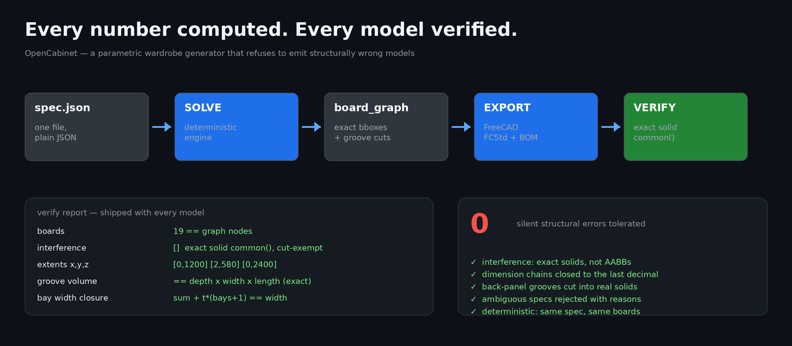

# OpenCabinet Wardrobe



**Parametric wardrobe generator with verified structural correctness.**

Describe a wardrobe in plain JSON (or one sentence, via any MCP-capable AI chat app), get back:

- a **3D model** (FreeCAD `.FCStd`, with real back-panel grooves cut into the carcass),
- a **cut list** (BOM, CSV),
- a **verification report** — interference check, dimension-chain closure, out-of-bounds check — every number computed by deterministic code, never guessed by a chatbot.

## Why

Most AI furniture generators produce plausible-looking models with silent structural errors: panels overlapping, backs that can't fit, dimension chains that don't close. OpenCabinet treats structural correctness as a **gate, not a hope**: every generated model passes deterministic validation before it is delivered.

Verification is the product. A model that fails any check is not emitted.

## What "verified" means

Every generated wardrobe passes all of:

| Check | Method |
|---|---|
| No interference | Exact solid `common()` volume between every board pair (AABB is not trusted — grooved boards keep a full bounding box) |
| Dimension chain closed | `min/max` of all board extents must equal the declared W×D×H exactly |
| No out-of-bounds boards | Every board bbox inside the carcass envelope |
| Back-panel grooves real | Groove volume cross-checked against expected `depth × width × length` |
| Layout feasibility | Bay widths + partition thicknesses must sum to width exactly; door seams must agree with bay boundaries |

## Install

```bash
pip install -e .          # engine only (pure Python + FreeCAD-independent checks)
# 3D export needs FreeCAD (https://www.freecad.org), command-line only is fine:
#   freecadcmd --version
```

## Quick start

```bash
# 1) Solve a wardrobe from a spec (pure Python, no FreeCAD needed)
opencabinet solve examples/wardrobe_1200.json --output out/

# 2) Export FCStd with real grooves (needs FreeCAD's freecadcmd)
opencabinet export out/board_graph.json --output out/fc/

# 3) Verify the produced model
opencabinet verify out/fc/UnitCab.FCStd --graph out/board_graph.json
```

### Via AI chat (MCP)

```bash
claude mcp add opencabinet -- opencabinet-mcp
```

Then just ask your chat app: *"Design a 2000mm wide, 2400mm tall, 580mm deep wardrobe, 3 bays, middle bay for long hanging, shelves on the sides, doors all across."*

## Spec format (one wardrobe)

```json
{
  "id": "wardrobe_1200",
  "cabinet_type": "wardrobe",
  "width": 1200, "depth": 580, "height": 2400,
  "board_thickness": 18,
  "gap": 2.5,
  "plinth_height": 60,
  "back": "grooved_10",
  "functions": ["hang", "fold", "door"],
  "style": {
    "doors": {"mode": "full_height", "gap": 2.5},
    "hang_columns": [0],
    "fold": {"column": 1, "top": true},
    "drawer": {"count": 0}
  },
  "column_count": 2,
  "column_widths": [573.0, 573.0],
  "facade_openings": [
    {"bay_indices": [0], "door_count": 1},
    {"bay_indices": [1], "door_count": 1}
  ]
}
```

Rules the engine enforces (rejects your spec otherwise):

- `sum(column_widths) + board_thickness × (bays + 1) == width` — exactly, no rounding drift
- `facade_openings` cover every bay once, consecutively, left-to-right; an opening may span several bays and its internal door seams need not align with bay boundaries — but opening boundaries must match the equal-width facade generator's seams
- hanging bays need clear height ≥ 900 mm (short) / ≥ 1400 mm (long)
- drawers sit at the bottom of their bay

See [`docs/spec.md`](docs/spec.md) for the full field reference.

## Verification reports

Both example specs ship with their actual gate reports (generated by the engine, not hand-written):

- [`examples/reports/wardrobe_1200.self_check.json`](examples/reports/wardrobe_1200.self_check.json) — 19 boards, passed
- [`examples/reports/wardrobe_2000_3bay.self_check.json`](examples/reports/wardrobe_2000_3bay.self_check.json) — 22 boards, passed

Door-width guidance: the engine warns when a door falls outside 400–500 mm (typical two-per-bay doors); 1200 mm cabinets legitimately end up near 600 mm per door — the warning is advisory by design (style-first), structural checks stay hard.

## Status

Early. Wardrobe only — by design: one cabinet family, done properly, beats eight done approximately. Roadmap: sideboards → shoe cabinets → kitchen base cabinets.

- ✅ Wardrobe: 19-board reference model verified (0 interference, chain closed, grooves exact)
- ✅ Deterministic gate: invalid/ambiguous specs are rejected with measurable reasons
- 🔲 Hardware (hinges, slides) with real part numbers
- 🔲 Sheet nesting / cut optimization
- 🔲 Web viewer (single-file HTML, no backend)

## License

MIT. See [LICENSE](LICENSE).
